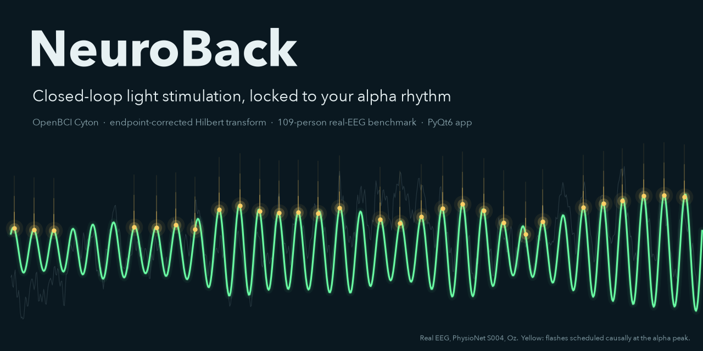
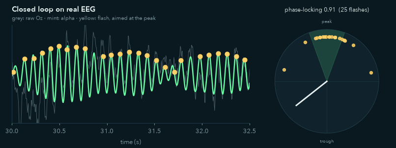
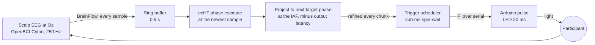
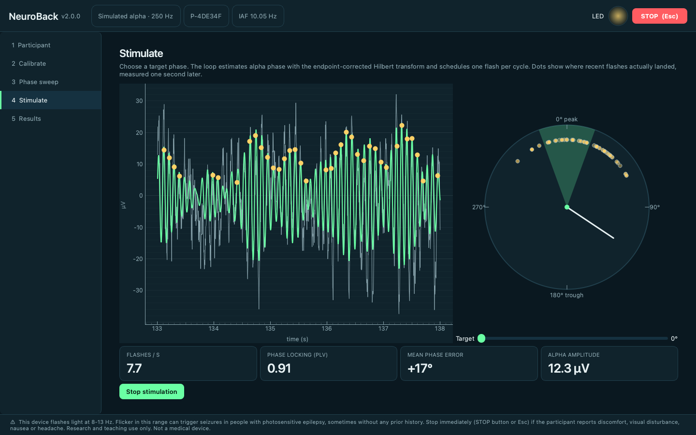
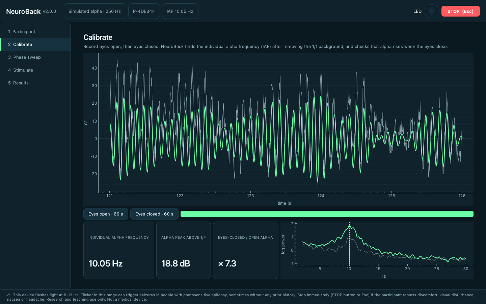
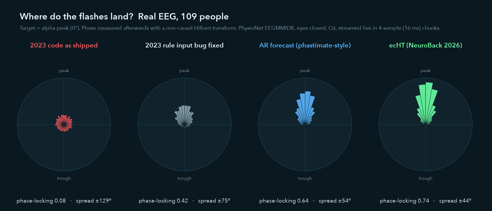
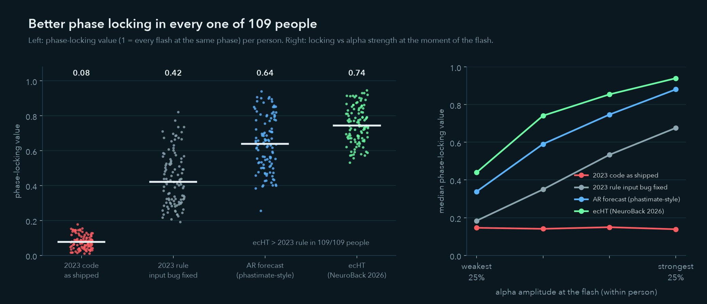
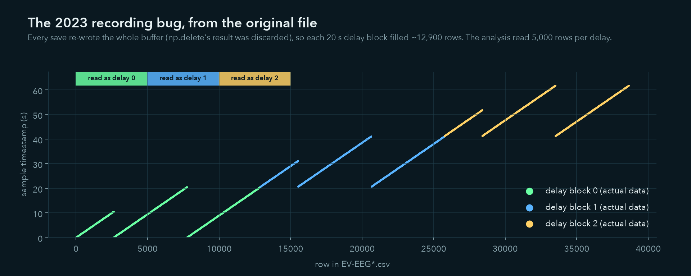

<p align="center">
  
</p>

<p align="center">
  <a href="https://github.com/abrilcode/neuroback/actions/workflows/ci.yml"></a>
  
  
  
  <a href="LICENSE"></a>
  
</p>

**NeuroBack reads your brain's alpha rhythm in real time and flashes a light at a chosen point of every cycle.** It's an open-source, closed-loop EEG system for the OpenBCI Cyton. Research groups (PLOS Biology 2024) and consumer sleep headbands (Elemind) use the same technique, phase-locked sensory stimulation.

It started as a 2023 university project at ITBA (Buenos Aires) that reproduced Huang et al. (2019). In 2026 it was rebuilt from the ground up:
- **Modern phase tracking:** the endpoint-corrected Hilbert transform.
- **A reproducible benchmark:** real EEG from 109 people.
- **Proper controls:** sham-style control conditions in the protocol.
- **Safety and privacy built in.**
- **An honest post-mortem** of what the original got wrong.

<p align="center"></p>

## Highlights

- **Hits the target phase on real EEG.**
  - Median phase-locking value **0.74** across 109 people, eyes closed. The 2023 rule scored **0.42** with its input bug fixed and **0.08** as shipped.
  - ecHT beat the 2023 rule in **109 of 109** people.
  - The four target phases 0°, 90°, 180° and 270° land within **3°** on average.
- **Locks hardest when alpha is strong.** Phase-locking reaches **0.94** in each person's strongest-alpha quartile, and an amplitude gate skips cycles without a clear rhythm.
- **Robust to real hardware timing.**
  - Every sample is used: the 2023 loop silently dropped all but the last sample of each USB burst.
  - Each flash time is refined as new data arrive.
  - A measured output latency is compensated, and 3 ms of timing jitter costs only 0.01 in phase-locking value. For scale, the Cyton's measured jitter with the FTDI fix is 2.1 ms (Knierim et al., 2023).
- **Controls built in.** The phase sweep repeats four target phases in randomised order, alongside open-loop flicker at the individual alpha frequency (IAF) and random-phase flashes, with alpha measured in the stimulus-free gap after each block. A permutation test reports whether alpha really depends on phase.
- **Safe and private by default.**
  - Stimulation stays locked until photosensitivity screening and consent are recorded, and there is an Esc emergency stop.
  - Participants exist only as random pseudonyms, and every SQL query is parameterised.
  - "Delete participant" removes everything.
- **Runs without hardware.** Simulated alpha, playback of public EEG, or BrainFlow's synthetic board, with 30+ tests and CI.

## Quick start

```bash
git clone https://github.com/abrilcode/neuroback && cd neuroback
pip install -e ".[all]"

neuroback demo                      # headless closed loop on simulated alpha, prints accuracy
neuroback gui                       # desktop app on simulated alpha (on-screen LED)
neuroback gui --board playback      # replay real EEG (PhysioNet subject 1, downloaded on demand)
neuroback benchmark                 # reproduce the 109-person benchmark (~140 MB download, ~2 min)
```

With hardware (OpenBCI Cyton + Arduino with [`firmware/neuroback_trigger`](firmware/neuroback_trigger/neuroback_trigger.ino)):

```bash
neuroback gui --board cyton --port /dev/cu.usbserial-XXXX --channel 8 \
              --trigger-port /dev/cu.usbmodemXXXX --latency-ms 12
```

Read [docs/hardware.md](docs/hardware.md) first: it covers the electrode montage, the FTDI latency fix, LED safety, and how to measure `--latency-ms` with a photodiode.

## How it works



1. **Calibrate.** Record 60 s eyes open and 60 s eyes closed. NeuroBack finds the individual alpha frequency after removing the 1/f background, to about 0.05 Hz; the 2023 grid was 1.34 Hz. It also checks that alpha rises when the eyes close.
2. **Phase sweep.** Four target phases plus two controls with the same flash rate, each repeated in randomised blocks (20 s on, 10 s off). A cosine fit with a permutation test checks whether post-block alpha depends on phase.
3. **Stimulate.** Pick a target phase. The app shows where each flash actually landed one second later, with live phase-locking, mean error and flash rate.

<table>
<tr>
<td></td>
<td></td>
</tr>
<tr>
<td align="center"><sub>Stimulate: target wedge, live phase needle, where flashes landed (dots)</sub></td>
<td align="center"><sub>Calibrate: IAF after 1/f removal, eyes-closed vs eyes-open spectra</sub></td>
</tr>
</table>

## Benchmark: does it hit the phase it aims for?

Each phase-tracking method processed the 1-minute eyes-closed recordings of all 109 people in the [PhysioNet EEG Motor Movement/Imagery Database](https://physionet.org/content/eegmmidb/1.0.0/) as a live stream:
- channel Oz, resampled to the Cyton's 250 Hz, delivered in 4-sample (16 ms) chunks. That is a middle ground: with the 1 ms FTDI fix the Cyton delivers samples almost one at a time, while its default buffering sends ~60-sample bursts that would make the 2023 dropped-sample bug far worse;
- aimed at the alpha peak;
- every flash scored afterwards against the non-causal Hilbert phase.

Settings were tuned on synthetic data only, so the real EEG is held out. Full method: [docs/benchmark.md](docs/benchmark.md).

<p align="center"></p>
<p align="center"></p>

| Method | Phase-locking value, median (IQR) | Spread (circular SD) | Bias | Cycles stimulated | With 3 ms jitter |
|---|---|---|---|---|---|
| 2023 code, as shipped (oracle delay) | 0.08 (0.04–0.11) | ±129° | 11.4° | 25% | 0.07 |
| 2023 rule, input bug fixed (oracle delay) | 0.42 (0.31–0.53) | ±75° | 1.0° | 100% | 0.41 |
| AR forecast (phastimate-style) | 0.64 (0.52–0.78) | ±54° | 4.0° | 83% | 0.63 |
| **ecHT (NeuroBack 2026)** | **0.74 (0.67–0.83)** | **±44°** | **4.2°** | **82%** | **0.73** |

The 2023 rows get an *oracle* delay, the best possible one for each person. That is more generous than the original calibration sweep, which could not find it (see the post-mortem).

## What changed since 2023

Version 1 was a real end-to-end system: Cyton acquisition, real-time filtering, an Arduino-driven LED, a PyQt6 GUI and a session database. Re-reading it in 2026 turned up bugs that meant the core result was never actually measured. The full audit, reproduced from the original files, is in [docs/postmortem-2023.md](docs/postmortem-2023.md).

| 2023 | 2026 |
|---|---|
| Fed only the last sample of each USB burst to the filter, giving near-random phase (0.08) | Every sample goes into the estimator (ecHT 0.74) |
| Rising zero-crossing on a causal ±1 Hz band-pass: ±90° error at 1 Hz off-centre, ~225 ms group delay | Endpoint-corrected Hilbert transform, with optional AR forecasting |
| Final stage passed the *index* of the best delay (0–10) to `time.sleep` as **seconds** | One scheduler thread; deadlines in seconds by construction, refined every chunk |
| `np.delete` result discarded, so files repeated samples 2.5–4.5×, and per-delay windows read the wrong blocks | Each sample stored once (`.npz` + JSON events) |
| 11 delays × 20 s, once each, in ascending order, so drift looked like a phase effect | Randomised repeated blocks, two flash-rate-matched controls, permutation test |
| IAF on a 1.34 Hz grid (only 8.02, 9.36, 10.70 or 12.03 Hz possible) | 1/f-corrected peak on a ~0.05 Hz grid, plus an eyes-closed reactivity check |
| Patient *names* as SQL table names via f-strings, names and EEG stored together | Random pseudonyms, fixed schema, parameterised queries, erasure |
| No photosensitivity safeguard for a ~10 Hz flashing LED | Screening + consent gate, warning, Esc emergency stop |

<p align="center"></p>

## The science, honestly

Phase-locked sensory stimulation is a real and active field. Sounds timed to the alpha phase shift alpha power and frequency depending on phase (Hebron et al., *PLOS Biology* 2024). A headband that plays sounds out of phase with alpha shortened sleep onset by 10.5 min versus a no-sound week (Bressler et al., *Sci Rep* 2024). NeuroBack's visual method comes from Huang et al. (*NeuroImage* 2019), which so far has been replicated only by its own group.

**Clinical claims are a different matter.** The 2023 slides suggested benefits for ADHD, anxiety, Parkinson's disease and migraine. Recent evidence does not support those claims for alpha protocols:
- **ADHD:** a 38-trial meta-analysis found SMD 0.04 when raters were probably blinded (Westwood et al., *JAMA Psychiatry* 2025).
- **Children, alpha training:** a 2026 double-blind trial of personalised upper-alpha neurofeedback found no difference from sham (Wang et al., *J Child Psychol Psychiatry* 2026).
- **Alpha rising is not evidence of control:** a preregistered study found alpha rose during a session whether the feedback was real or sham (Maaz et al., *Communications Psychology* 2026).

<p align="center"></p>

So NeuroBack is presented for what it is: **a research and teaching instrument for closed-loop, phase-locked stimulation, with measured engineering performance.** It is not a treatment. The full review, including where neurofeedback *does* show specific effects (closed-loop motor rehabilitation after stroke, small effects for standard ADHD protocols), is in [docs/science.md](docs/science.md).

## Safety

> [!WARNING]
> NeuroBack flashes light at 8–13 Hz. Flicker in this range can trigger seizures in people with photosensitive epilepsy, sometimes with no prior history. Screen every participant, use a diffused LED at modest brightness, keep the Esc stop within reach, and stop at the first sign of discomfort. Research and teaching use only. Not a medical device, and no diagnostic or therapeutic claims are made. See [docs/safety-and-privacy.md](docs/safety-and-privacy.md).

## Repository

```
src/neuroback/
  phase.py         ecHT, AR forecast, and the 2023 rule (for comparison)
  closedloop.py    engine: phase -> next target time, latency compensation, controls
  dsp.py           IAF (1/f-corrected), band power, offline ground-truth phase
  sources.py       Cyton / BrainFlow, simulated alpha, playback
  stimulators.py   serial trigger + sub-millisecond scheduler
  protocol.py      randomised phase sweep with controls
  analysis.py      circular statistics, cosine fit, permutation test
  storage.py       pseudonymous SQLite store with erasure
  safety.py        photosensitivity screening
  gui/             PyQt6 app
  bench/           PhysioNet loader + phase benchmark
firmware/          Arduino trigger (LED + TTL marker for the Cyton)
scripts/           figure generation (every figure is reproducible)
docs/              benchmark, science review, hardware, protocol, safety, 2023 post-mortem
legacy/2023/       the original 2023 code, unchanged
```

## Roadmap

- [ ] Hardware validation: photodiode loop-back measurements of latency and jitter on a Cyton, published in `docs/`.
- [ ] Auditory pulses as an alternative stimulus: this is the version independently replicated, and it avoids photosensitivity risk.
- [ ] State-space phase estimator (Wodeyar et al., 2021) with credible intervals.
- [ ] Lab Streaming Layer output and XDF recording for MNE-LSL / LabRecorder workflows.
- [ ] A preregistered, sham-controlled pilot (CRED-nf checklist) before any behavioural claim.

## Citing

If you use NeuroBack, please cite the software ([CITATION.cff](CITATION.cff)) and the methods it builds on: Huang et al. 2019; Schreglmann et al. 2021; Zrenner et al. 2020. Cite the dataset too: Schalk et al. 2004; Goldberger et al. 2000.

## Credits

Created by **Abril Herrlein**. NeuroBack began in 2023 as a course project for *Instrumentación Biomédica II* at the Instituto Tecnológico de Buenos Aires (ITBA) and was rebuilt as v2 in 2026.

## Key references

1. Huang G. et al. (2019). A novel training-free externally-regulated neurofeedback (ER-NF) system using phase-guided visual stimulation for alpha modulation. *NeuroImage* 189, 688–699. doi:10.1016/j.neuroimage.2019.01.072
2. Schreglmann S.R. et al. (2021). Non-invasive suppression of essential tremor via phase-locked disruption of its temporal coherence. *Nature Communications* 12, 363. doi:10.1038/s41467-020-20581-7
3. Zrenner C. et al. (2020). The shaky ground truth of real-time phase estimation. *NeuroImage* 214, 116761. doi:10.1016/j.neuroimage.2020.116761
4. Hebron H. et al. (2024). A closed-loop auditory stimulation approach selectively modulates alpha oscillations and sleep onset dynamics in humans. *PLOS Biology* 22, e3002651. doi:10.1371/journal.pbio.3002651
5. Bressler S. et al. (2024). A randomized controlled trial of alpha phase-locked auditory stimulation to treat symptoms of sleep onset insomnia. *Scientific Reports* 14, 13039. doi:10.1038/s41598-024-63385-1
6. Westwood S.J. et al. (2025). Neurofeedback for attention-deficit/hyperactivity disorder: a systematic review and meta-analysis. *JAMA Psychiatry* 82(2), 118–129. doi:10.1001/jamapsychiatry.2024.3702
7. Maaz J. et al. (2026). Alpha power increases spontaneously during a neurofeedback session. *Communications Psychology* 4, 75. doi:10.1038/s44271-026-00431-w
8. Knierim M.T., Bleichner M.G., Reali P. (2023). A systematic comparison of high-end and low-cost EEG amplifiers for concealed, around-the-ear EEG recordings. *Sensors* 23, 4559. doi:10.3390/s23094559
9. Schalk G. et al. (2004). BCI2000: a general-purpose brain-computer interface (BCI) system. *IEEE Transactions on Biomedical Engineering* 51, 1034–1043. doi:10.1109/TBME.2004.827072
10. Goldberger A.L. et al. (2000). PhysioBank, PhysioToolkit, and PhysioNet. *Circulation* 101, e215–e220. doi:10.1161/01.CIR.101.23.e215

Full reference list: [docs/science.md](docs/science.md).
