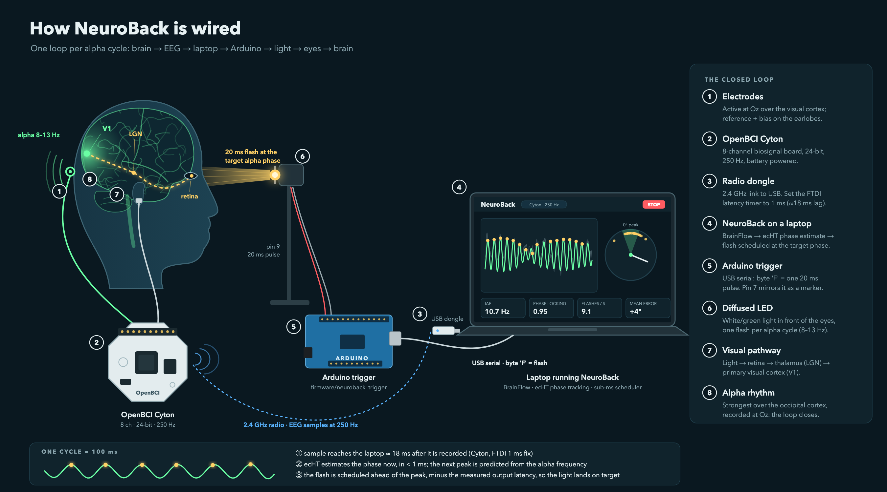
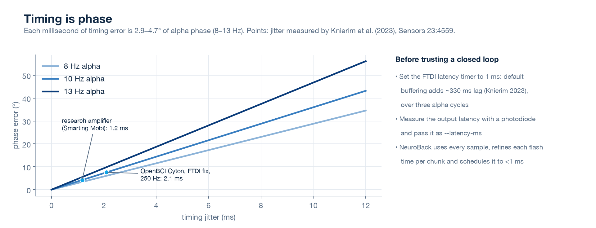

# Hardware

## Bill of materials

| Part | Notes |
|---|---|
| OpenBCI Cyton (8-channel, 250 Hz) + USB dongle | The 2023 project used this board. BrainFlow's synthetic board and NeuroBack's simulated / playback sources work without it. |
| Gold-cup or Ag/AgCl electrodes, conductive paste, abrasive prep gel | One active electrode at Oz, reference and bias on the earlobes or mastoids |
| Arduino Uno / Nano / Mega | Runs [`firmware/neuroback_trigger`](../firmware/neuroback_trigger/neuroback_trigger.ino) |
| White or green LED + diffuser + 220–470 Ω resistor | Avoid saturated red light (see [safety-and-privacy.md](safety-and-privacy.md)). Use a MOSFET for high-power LEDs. |
| Photodiode or phototransistor (optional, recommended) | Measures the true flash time for latency calibration |

## Montage

- **Active electrode:** Oz (occipital midline), where alpha is strongest with the eyes closed. Fp1, used in 2023, mostly picks up eye blinks; avoid it for alpha tracking.
- **Reference and bias:** SRB2 and BIAS to the left and right earlobes (or mastoids).
- **Channel:** pass the Cyton input you used as `--channel` (default 8).
- **Impedance:** below ~10 kΩ. Check alpha reactivity in the Calibrate step: eyes-closed alpha should be clearly above eyes-open alpha (×2 or more).

## Fix the Cyton's USB latency first

The Cyton dongle uses an FTDI chip whose latency timer defaults to 16 ms. With that default, samples arrive in large bursts and lag the real signal by ~330 ms (Knierim et al., 2023), more than three alpha cycles. With the timer at 1 ms, the same study measured 18 ms lag and 2.1 ms jitter at 250 Hz.

- **Windows:** Device Manager → Ports → *USB Serial Port* → Advanced → Latency Timer = 1 ([OpenBCI guide](https://docs.openbci.com/Troubleshooting/FTDI_Fix_Windows/)).
- **Linux:** `echo 1 | sudo tee /sys/bus/usb-serial/devices/ttyUSB0/latency_timer`
- **macOS:** follow the [OpenBCI macOS FTDI guide](https://docs.openbci.com/Troubleshooting/FTDI_Fix_Mac/). Recent macOS versions use Apple's built-in driver, so check the current instructions.

## Measure your output latency (photodiode loop-back)

NeuroBack can compensate a fixed output delay (`--latency-ms`), but it has to be measured on your setup. The delay covers the radio link, USB, the serial write, the Arduino and the LED rise time.

1. Tape a photodiode over the LED. Wire it to one of the Cyton's analog inputs (A5–A7) and put the board in analog-read mode (`/2` command; see the OpenBCI Cyton SDK docs). Alternatively, wire the Arduino's `TRIGGER_OUT` (pin 7) to a Cyton digital input in digital-read mode (`/3`) to log commanded flash times.
2. Run `neuroback gui --board cyton ... --latency-ms 0` and stimulate at 0° for 2 minutes.
3. In the saved session, compare commanded flash times (`events.json`) with photodiode onsets on the EEG clock. The median difference is your latency; its spread is your jitter.
4. Restart with `--latency-ms <median>`. At 10 Hz, every 1 ms of error costs 3.6° of phase.

## Firmware protocol

- **Link:** serial at 115200 baud.
- **Commands:**

  | Byte | Action |
  |---|---|
  | `F` | One 20 ms pulse (non-blocking) |
  | `p` / `a` | LED on / off (2023 protocol) |
  | `?` | Identify |

- **TTL marker:** pin 7 mirrors the LED as a TTL marker.
