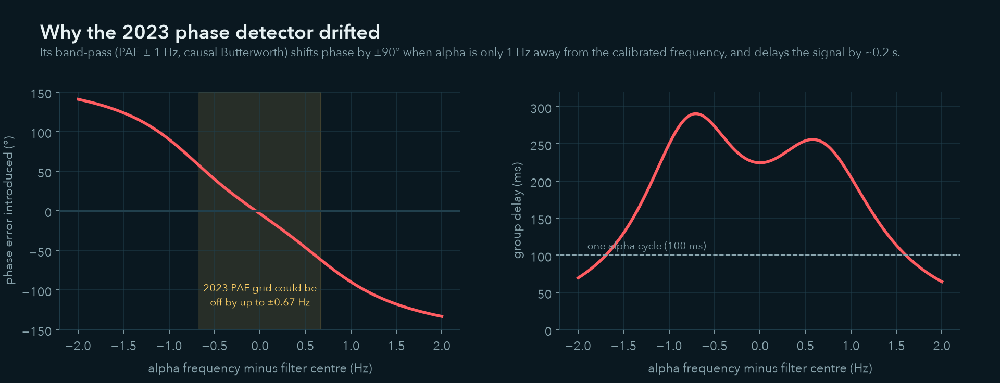

# Post-mortem: NeuroBack v1 (ITBA, November 2023)

NeuroBack v1 was a course project for *Instrumentación Biomédica II* at ITBA, handed in on 23 November 2023. It reproduced Huang et al. (2019):
- an OpenBCI Cyton streamed EEG through BrainFlow into a PyQt6 app;
- a causal band-pass at the participant's peak alpha frequency (PAF) detected rising zero-crossings;
- an Arduino Mega flashed an LED after a delay;
- a calibration sweep picked the delay that maximised alpha power.

**What worked.** It was a complete closed-loop system: acquisition, real-time DSP, a hardware trigger, a clinician GUI and a session database. That is the hard part to get running.

**What this document covers.** Re-reading the code and files in 2026 showed that the headline result, alpha power as a function of stimulation delay, was never actually measured. Each finding below was reproduced from the original code (`legacy/2023/`) and data files.

## Findings

| # | Finding | Evidence | Effect |
|---|---|---|---|
| 1 | **Only the last sample of each chunk reached the filter** | `D = data[canal][-1]` inside the acquisition loop. The code printed `error` whenever more than one sample arrived. | With the Cyton's USB dongle, samples arrive in bursts. The filter saw an irregularly sub-sampled signal while its coefficients assumed 250 Hz. Benchmark: phase-locking 0.08, essentially random, with only 25% of cycles triggered. |
| 2 | **The final stimulation used the wrong delay** | `delay_time = self.delaymax`. `delaymax` is `np.argmax(...)`, an index 0–10, and it was passed to `time.sleep()` as seconds. | The stimulation stage never ran at the calibrated phase: flashes came 0–10 s after each crossing. |
| 3 | **Recordings duplicated samples** | `np.delete(DATA, np.s_[:], axis=1)` returns a new array, and the result was discarded. The full buffer was re-written at every save, and again on idle loop passes. | The evaluation file had 2.51× as many rows as unique samples, the stimulation file 4.52×. |
| 4 | **Per-delay alpha power came from the wrong data** | Delay *i* was read from rows `i*5000 … (i+1)*5000`, but because of #3 each 20 s block occupied ~12,900 rows. In the original file, the window for delay 1 lies entirely inside block 0. | The power-vs-delay curve and the chosen "best delay" did not correspond to the delays tested. |
| 5 | **Phase detection was fragile** | Causal 2nd-order Butterworth at PAF ± 1 Hz, described as "FIR order 2" in the slides; it is IIR. Phase shift is ±90° at ±1 Hz from centre, and group delay is ~225 ms. | Natural cycle-to-cycle frequency drift became large phase errors that no fixed delay can fix. Benchmark with the input bug fixed: 0.42. |
| 6 | **PAF resolution was 1.34 Hz** | Welch with `nperseg = int(250*0.75) = 187` | Only 8.02, 9.36, 10.70 or 12.03 Hz were possible. The filter centre could be ~0.7 Hz off the true PAF, which is roughly 60° of extra phase error by #5. |
| 7 | **Channels were inconsistent** | PAF came from EEG channel 6, phase and power from channel 7, and the live plot showed channel 1 | It is unclear which electrode drove the loop. The report places electrodes at Fp1 (dominated by blinks) and Oz. |
| 8 | **The sweep confounded phase with time** | Each delay ran once, for 20 s, in ascending order, with no sham and no statistics | Alpha rises with time on task whatever the feedback (Maaz et al., 2026). In the presented curve (PAF 9.8 Hz, period ≈ 102 ms), the 100–125 ms points should match the 0–25 ms points if the effect followed phase. All three were higher, which is what drift looks like. |
| 9 | **Patient data handling** | The patient name was used as a SQL table name in an f-string. Names and EEG were stored in plain files. | SQL injection was possible. Names with spaces, accents or duplicates broke the database. There was no consent record. |
| 10 | **No photosensitivity safeguard** | A ~10 Hz flashing LED, inside the 3–30 Hz band most likely to trigger photosensitive seizures | No screening, warning or emergency stop. |
| 11 | **The recorded data were simulated** | The CSVs have BrainFlow's synthetic-board layout: 32 columns, channels peaking at exactly 5, 10 … 40 Hz, and a constant 36.6 °C temperature column | The submitted files are a dry run. No real EEG from the project survives. |

## Lessons for the rebuild

- **Test the loop on recordings before people.** A replay mode with a known ground truth would have caught #1, #4 and #5 in minutes. v2 ships one, plus a benchmark.
- **Units in names, seconds everywhere.** #2 is a one-character class of bug. v2 has a single scheduler whose deadlines are absolute times.
- **Randomise and repeat conditions, and include flash-rate-matched controls.** Otherwise slow drift and the steady-state visual response pass for phase effects.
- **Treat EEG plus identity as health data from day one.** v2 uses pseudonyms and parameterised SQL, records consent, and supports erasure.
- **Claims follow evidence.** The 2023 slides listed ADHD, anxiety, Parkinson's and migraine as applications. The evidence for alpha protocols does not support that (see [science.md](science.md)).
