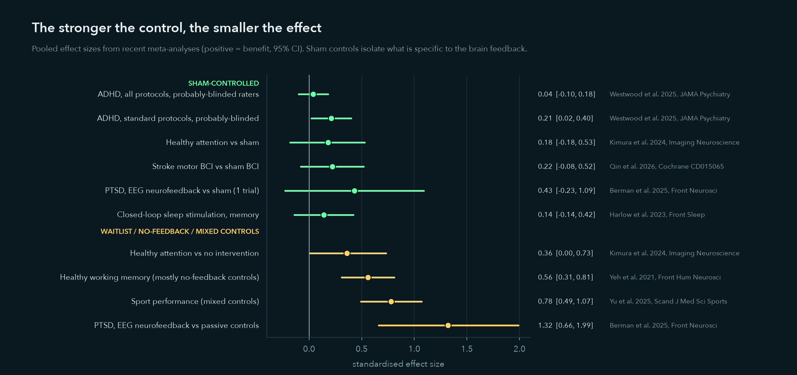

# The science behind NeuroBack, and its limits

Reviewed October 2026. Effect sizes are standardised mean differences (SMD, Hedges g or Cohen d) with 95% CIs, oriented so that positive means benefit. The reference list is at the end.

## 1. What NeuroBack does

NeuroBack is **closed-loop, phase-locked sensory stimulation**:
- it estimates the phase of the ongoing alpha rhythm (8–13 Hz) in real time;
- it delivers a brief flash at a chosen phase of each cycle.

Huang et al. (2019) proposed the visual version and called it "training-free externally-regulated neurofeedback". Unlike classic neurofeedback, the participant learns nothing. The stimulus itself pushes the oscillation, like timing pushes on a swing.

## 2. Evidence for the method

- **Phase-dependent alpha modulation is real and has been reproduced, with sound rather than light.**
  - Hebron et al. (2024, *PLOS Biology*) delivered pink-noise pulses at four alpha phases using the endpoint-corrected Hilbert transform (ecHT).
  - Alpha power and frequency changed depending on phase.
  - In a sham-controlled nap study, 15 of 16 participants showed the predicted change in alpha frequency.
  - Effects stopped when stimulation stopped.
- **Precise alpha-phase tracking works on consumer hardware.** Harlow et al. (2024, *eNeuro*) used an Elemind headband: ecHT gave PLV 0.92, against 0.68 for a plain Hilbert transform.
- **A consumer product uses alpha-phase-locked sound.** Bressler et al. (2024, *Sci Rep*): a home crossover with 21 participants analysed.
  - Sound timed to alpha shortened sleep onset by 10.5 min (−29%) compared with a no-sound week.
  - Caveats: the sham was silent, and the authors work for the sponsor.
- **The visual version is less established.**
  - Huang et al. (2019) has been followed up almost only by the same Shenzhen group, including an OpenBCI implementation in 2020. No independent, sham-controlled replication has been published.
  - Behavioural effects of visual alpha-phase cues are weak (Vinao-Carl et al., 2024, *NeuroImage*).
- **Flashing near the alpha frequency drives a steady-state visual evoked response.** That response adds power at the stimulation frequency whether or not the ongoing rhythm is entrained. This is why NeuroBack's sweep measures alpha in the *stimulus-free gap* after each block, and includes open-loop and random-phase controls with the same flash rate.
- **Related closed-loop work.**
  - Phase-tuned transcranial alternating current stimulation (tACS) improved working memory at the best phase (d ≈ 0.98; Haslacher et al., 2024, *Brain Stimulation*). The best phase was chosen after the fact.
  - Closed-loop auditory stimulation during slow-wave sleep shows shrinking memory effects in later studies (meta-analysis d ≈ 0.14, CI −0.14 to 0.42; Harlow et al., 2023).

## 3. Evidence for classic EEG neurofeedback

Effects shrink as the control condition gets closer to a real sham. Sham means the same setup, but the feedback does not depend on your brain.

### Beats a sham

- **Stroke motor rehabilitation with a brain–computer interface (BCI).** Here, attempted movement detected from EEG triggers electrical muscle stimulation or an orthosis.
  - Biasiucci et al. (2018, *Nat Commun*; n = 27, double-blind sham electrical stimulation): arm Fugl-Meyer score improved +6.6 vs +2.1 points, and the gains lasted 6–12 months.
  - Ramos-Murguialday et al. (2013, *Ann Neurol*; n = 32) also beat a sham.
  - **But** the 2026 Cochrane review (Qin et al.; 43 RCTs, 1,628 patients) rates the benefit over sham as uncertain: SMD 0.22 (−0.08 to 0.52), 9 trials, low certainty. Against conventional therapy alone, BCI adds about 4.7 Fugl-Meyer points (low certainty).
- **ADHD with standard protocols** (theta/beta, SMR, slow cortical potentials):
  - Probably-blinded raters: SMD 0.21 (0.02–0.40), k = 9.
  - Across all protocols: SMD 0.04 (−0.10 to 0.18) (Westwood et al., 2025, *JAMA Psychiatry*; 38 RCTs, n = 2,472).
- **Brain after-effects in healthy people.** A single 30-minute alpha-suppression session increased salience-network connectivity compared with sham, still present 30 minutes later (Ros et al., 2013, *NeuroImage*; 17 vs 17). This is a change in the brain, not a demonstrated benefit.

### Does not beat sham, or has not been tested against it

- **Alpha protocols specifically.**
  - Personalised upper-alpha neurofeedback in children with ADHD did not differ from sham (Wang et al., 2026, *J Child Psychol Psychiatry*; n = 48, double-blind), even though most children learned the regulation.
  - Alpha neurofeedback for attention in healthy adults: SMD 0.18 against sham, not significant (Kimura et al., 2024, *Imaging Neuroscience*).
  - In a preregistered double-blind study, alpha rose during a session with real feedback, sham feedback and passive viewing alike (Maaz et al., 2026, *Communications Psychology*). **Alpha rising in a session is not evidence that the system works.**
- **The indications in the 2023 slides.**
  - **Generalised anxiety:** only small quasi-experimental studies against waitlist (e.g. Dadashi et al., 2015).
  - **Migraine:** Pan et al. (2022, *Pain*) found *higher* resting occipital alpha in patients who responded worse to preventive treatment. That makes it a predictor of outcome, not a training target.
  - **Parkinson's:** EEG changes, but no reliable motor improvement in a 2025 meta-analysis.
- **Big numbers against waitlist.** PTSD (SMD 1.32 vs passive controls; Berman et al., 2025), addiction and memory in healthy people show large effects against waitlist or no-feedback controls. Against sham they mostly disappear: PTSD vs sham SMD 0.43 (−0.23 to 1.09) from one trial. People do improve, often a lot, but in the best-blinded trials the sham group improves about as much (Arnold et al., 2021; Cortese et al., 2016).

### Regulation

- **United States:** biofeedback devices, explicitly including "brain alpha wave activity", are FDA Class II (21 CFR 882.5050). No EEG neurofeedback device is FDA-authorised to treat ADHD, anxiety, migraine or Parkinson's.
- **Products on the market:** Elemind sells as a general-wellness product. The IpsiHand stroke BCI received FDA De Novo authorisation in 2021.

## 4. What NeuroBack claims

> NeuroBack is a research and teaching instrument for closed-loop, phase-locked visual stimulation. Its validated claims are engineering ones: phase-tracking accuracy on real EEG (see [benchmark.md](benchmark.md)), latency compensation and timing. It is not a medical device and makes no diagnostic or therapeutic claims. Any claim about effects on alpha or behaviour requires a preregistered, sham-controlled study reported to the CRED-nf checklist (Ros et al., 2020).

## References

- Arnold L.E. et al. (2021). Double-blind placebo-controlled randomized clinical trial of neurofeedback for ADHD with 13-month follow-up. *JAACAP* 60, 841–855. doi:10.1016/j.jaac.2020.07.906
- Berman D.E. et al. (2025). Systematic review and meta-analysis of neurofeedback training efficacy and neural mechanisms in the treatment of PTSD. *Frontiers in Neuroscience* 19, 1658652. doi:10.3389/fnins.2025.1658652
- Biasiucci A. et al. (2018). Brain-actuated functional electrical stimulation elicits lasting arm motor recovery after stroke. *Nature Communications* 9, 2421. doi:10.1038/s41467-018-04673-z
- Bressler S. et al. (2024). A randomized controlled trial of alpha phase-locked auditory stimulation to treat symptoms of sleep onset insomnia. *Scientific Reports* 14, 13039. doi:10.1038/s41598-024-63385-1
- Cortese S. et al. (2016). Neurofeedback for ADHD: meta-analysis of clinical and neuropsychological outcomes from randomized controlled trials. *JAACAP* 55, 444–455. doi:10.1016/j.jaac.2016.03.007
- Dadashi M. et al. (2015). Effects of increase in amplitude of occipital alpha & theta brain waves on global functioning level of patients with GAD. *Basic and Clinical Neuroscience* 6, 14–20.
- D'Amico A., de Sa V.R. (2026). Comparing simultaneous scalp EEG recordings from the OpenBCI Cyton and Brain Products BrainAmp. *Sensors* 26, 1153. doi:10.3390/s26041153
- Harlow T.J. et al. (2023). Memory retention following acoustic stimulation in slow-wave sleep: a meta-analytic review of replicability and measurement quality. *Frontiers in Sleep* 2, 1082253. doi:10.3389/frsle.2023.1082253
- Harlow T.J. et al. (2024). Individualized closed-loop acoustic stimulation suggests an alpha phase dependence of sound evoked and induced brain activity measured with EEG. *eNeuro* 11. doi:10.1523/ENEURO.0511-23.2024
- Haslacher D. et al. (2024). Working memory enhancement using real-time phase-tuned transcranial alternating current stimulation. *Brain Stimulation* 17, 850–859. doi:10.1016/j.brs.2024.07.007
- Hebron H. et al. (2024). A closed-loop auditory stimulation approach selectively modulates alpha oscillations and sleep onset dynamics in humans. *PLOS Biology* 22, e3002651. doi:10.1371/journal.pbio.3002651
- Huang G. et al. (2019). A novel training-free externally-regulated neurofeedback (ER-NF) system using phase-guided visual stimulation for alpha modulation. *NeuroImage* 189, 688–699. doi:10.1016/j.neuroimage.2019.01.072
- Kimura I. et al. (2024). Efficacy of neurofeedback training for improving attentional performance in healthy adults: a systematic review and meta-analysis. *Imaging Neuroscience* 2. doi:10.1162/imag_a_00053
- Knierim M.T., Bleichner M.G., Reali P. (2023). A systematic comparison of high-end and low-cost EEG amplifiers for concealed, around-the-ear EEG recordings. *Sensors* 23, 4559. doi:10.3390/s23094559
- Maaz J. et al. (2026). Alpha power increases spontaneously during a neurofeedback session. *Communications Psychology* 4, 75. doi:10.1038/s44271-026-00431-w
- Pan L.-L.H. et al. (2022). Resting-state occipital alpha power is associated with treatment outcome in patients with chronic migraine. *Pain* 163, 1324–1334. doi:10.1097/j.pain.0000000000002516
- Qin Y. et al. (2026). Brain-computer interface training for motor recovery after stroke. *Cochrane Database of Systematic Reviews*, CD015065.pub2. doi:10.1002/14651858.CD015065.pub2
- Ramos-Murguialday A. et al. (2013). Brain–machine interface in chronic stroke rehabilitation: a controlled study. *Annals of Neurology* 74, 100–108. doi:10.1002/ana.23879
- Ros T. et al. (2013). Mind over chatter: plastic up-regulation of the fMRI salience network directly after EEG neurofeedback. *NeuroImage* 65, 324–335. doi:10.1016/j.neuroimage.2012.09.046
- Ros T. et al. (2020). Consensus on the reporting and experimental design of clinical and cognitive-behavioural neurofeedback studies (CRED-nf checklist). *Brain* 143, 1674–1685. doi:10.1093/brain/awaa009
- Schreglmann S.R. et al. (2021). Non-invasive suppression of essential tremor via phase-locked disruption of its temporal coherence. *Nature Communications* 12, 363. doi:10.1038/s41467-020-20581-7
- Shirinpour S. et al. (2020). Experimental evaluation of methods for real-time EEG phase-specific transcranial magnetic stimulation. *Journal of Neural Engineering* 17, 046002. doi:10.1088/1741-2552/ab9dba
- Wang Y. et al. (2026). A double-blind randomized controlled trial of personalized upper-alpha neurofeedback in children with ADHD. *J Child Psychol Psychiatry*. doi:10.1111/jcpp.70188
- Westwood S.J. et al. (2025). Neurofeedback for attention-deficit/hyperactivity disorder: a systematic review and meta-analysis. *JAMA Psychiatry* 82, 118–129. doi:10.1001/jamapsychiatry.2024.3702
- Wodeyar A. et al. (2021). A state space modeling approach to real-time phase estimation. *eLife* 10, e68803. doi:10.7554/eLife.68803
- Yeh W.-H. et al. (2021). Neurofeedback of alpha activity on memory in healthy participants: a systematic review and meta-analysis. *Frontiers in Human Neuroscience* 14, 562360. doi:10.3389/fnhum.2020.562360
- Yu C.-L. et al. (2025). The effect of EEG neurofeedback training on sport performance: a systematic review and meta-analysis. *Scand J Med Sci Sports* 35, e70055. doi:10.1111/sms.70055
- Zrenner C. et al. (2018). Real-time EEG-defined excitability states determine efficacy of TMS-induced plasticity in human motor cortex. *Brain Stimulation* 11, 374–389. doi:10.1016/j.brs.2017.11.016
- Zrenner C. et al. (2020). The shaky ground truth of real-time phase estimation. *NeuroImage* 214, 116761. doi:10.1016/j.neuroimage.2020.116761
